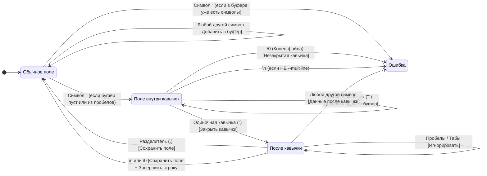
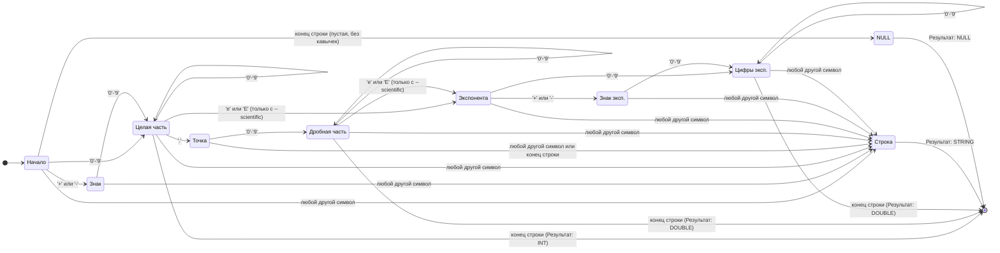

# Инструкция по компиляции(gcc)
Для сборки проекта используется следующая команда:

```bash
gcc -Wall -Wextra -std=c99 -I. src/types.c src/csv_parser.c src/binary_io.c src/analyzer.c src/main.c -o csvstat.exe
```
# Инструкция по компиляции(makefile)
​Use the Makefile in the root directory to compile the project:  
**​make** — Standard build.  
**​make sanitize** — Build with memory sanitizers.  
**​make release** — Optimized release build.  
**​make clean** — Remove compiled files.

# SYMBOL STATE MACHINE

# CELL TYPE STATE MACHINE

